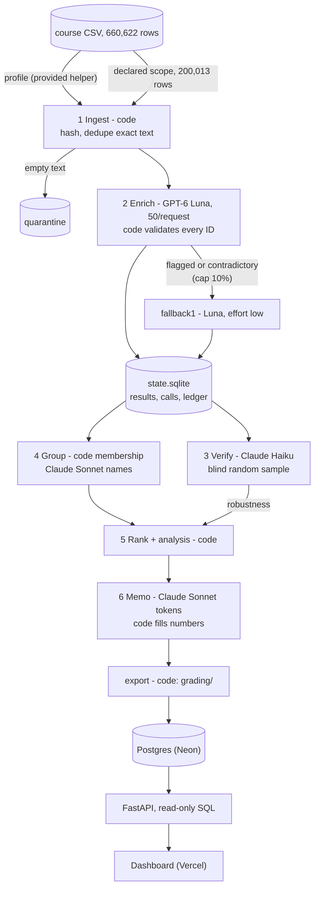

# Spotify Insight Pipeline (MBA 290T Assignment 5)

A staged program that turns 200,013 Spotify Google Play reviews into a ranked list of product issues and a
decision memo. Code ingests and profiles the course CSV and sends each distinct review text once, at most 50 per
request, to GPT-6 Luna for the contract labels. Claude Haiku re-labels a declared random sample blind. Code
groups complaints into issues (Claude Sonnet only names them), ranks them, and Claude Sonnet writes the memo
from saved aggregates while code fills in every number. Every handoff is a saved file or SQLite row, every model
call is logged with tokens and cost, and a stopped run resumes without re-sending finished reviews. A Postgres
database, a read-only FastAPI backend and a dashboard serve the results.

## At a glance

| | |
|---|---|
| Recommendation | **Billing/support: the free tier's Premium-only restrictions** (provisional; [below](#recommendation)) |
| Live dashboard | https://spotify-review-insights-iota.vercel.app (public, read-only, **no login**) |
| Scope | Declared 200,013-row scope ([Scope](#scope)); the full 660,622-row file is ingested and profiled |
| Coverage | 200,000 classified, 13 empty texts quarantined, 0 unfinished ([run_summary.json](runs/final-200k/run_summary.json)) |
| Course checker | `pass`, 0 issues, coverage candidate 1.0 ([self-check.json](runs/final-200k/self-check.json)) |
| Golden 50 (Eason's labels) | topic 76%, intent 74%, severity 76% exact (MAE 0.24) ([results.json](evals/golden/results.json)) |
| Blind verifier, 2,000 reviews | topic 81%, intent 92%, severity 79% exact ([report.json](runs/final-200k/verification/report.json)) |
| Spend | $2.142643 billed API for the whole project, $2.019246 of it the final run ([project_spend.json](cost/project_spend.json)); Claude roles on Claude Pro ($2.4502 API-equivalent, not billed) |
| Final run | [`runs/final-200k`](runs/final-200k/): 12 invocations, 9,682.057 s; grading export in [`grading/`](runs/final-200k/grading/) |

## Recommendation

From [runs/final-200k/memo.md](runs/final-200k/memo.md) (the model writes tokens, code fills every number; C## IDs
are in [claims.csv](runs/final-200k/claims.csv), A##/T## IDs in [memo_tokens.csv](runs/final-200k/memo_tokens.csv)).
Put next quarter's effort into **billing/support**, specifically the Premium-only restrictions issue
(`billing.premium_only`: 18,016 complaints (C01), severity sum 52,577 (C02), rank 1 of 22). Billing/support has the
highest baseline priority of the four decision areas (severity sum 59,146 (A02) against usability 54,124 (A05),
playback/performance 46,058 (A08) and access/onboarding 11,172 (A17)) and the largest increase in share of reviews
among them, +10.9 pp (T12). The memo frames it as free-tier packaging and entitlement policy (skip limits, forced
shuffle, no pick/repeat/rewind) for pricing and monetization, not a payment or support-backlog defect, and calls it
**provisional**: usability has more (if less severe) complaints, 23,004 (A04); the verifier's labels put
playback/performance first, 758 (T46) against 661 (T48); and an upper-bound sensitivity would drop billing/support
to third, 44,907 (T58) ([memo summary](#decision-memo)).

## Verify in 3 commands

No API key and no install: the checker, the rank check and the calculator use only the Python 3.12 standard
library. The course dataset is git-ignored; download the course ZIP (the "complete course dataset ZIP" on the
[course page](https://haas-ai-classes-fall-26.vercel.app/assignment5.html)) and unzip it into the expected folder:

```bash
curl -LO https://haas-ai-classes-fall-26.vercel.app/capstone/insight-pipeline/spotify-insight-dataset.zip
unzip spotify-insight-dataset.zip -d "Final Assignment - Spotify Reviews Dataset"
D="Final Assignment - Spotify Reviews Dataset"
# 1. Course checker on the declared scope -> "status": "pass", "issue_counts": {}, coverage candidate 1.0
python3 scripts/make_analysis_subset.py   # data/analysis_200k.csv, SHA-256 3c023c9d... (data/analysis_200k.manifest.json)
python3 "$D/check_submission.py" reference --full "$D/spotify_reviews_18months.csv" \
    --analysis data/analysis_200k.csv --out /tmp/ref.json
python3 "$D/check_submission.py" check --reference /tmp/ref.json --submission runs/final-200k/grading --out /tmp/check.json
# 2. Ranking rebuilt from grading/ with no model call -> "identical": true, "issues": 22
python3 -m insight rank --run-dir runs/final-200k --check
# 3. Offline cost replay, no state database -> spend to date $2.142643 over 12 run directories
python3 cost/calculator.py replay --out-dir /tmp/calc
```

The checker report carries `reference_sha256` `363b06ce...`, as in the saved `self-check.json`. Side effects: the
subset script and the rank check refresh a timestamp in their manifest and `rank_check.json`; plain
`python3 cost/calculator.py` regenerates the committed `cost/report.md`, `report.json` and `project_spend.json`.

## Rubric map

| # | Rubric item | Evidence |
|---|---|---|
| D1 | Accessible code, setup, artifacts | Public repo; [Verify in 3 commands](#verify-in-3-commands); [How to run](#how-to-run); blank `.env.example`; [evidence index](#where-to-find-everything) |
| D2 | Architecture, shared schema, provenance | [Architecture](#architecture) and [docs/architecture.md](docs/architecture.md); [docs/labels.md](docs/labels.md); `label_config` on every record; [Models and provenance](#models-and-provenance) |
| D3 | Memo numbers trace to calculations | [memo.md](runs/final-200k/memo.md): 40 claims in [claims.csv](runs/final-200k/claims.csv), 132 tokens with source files in [memo_tokens.csv](runs/final-200k/memo_tokens.csv); rechecked by the course checker and in SQL |
| D4 | Recommendation, alternatives, limitations | Memo: 3 actions, what would change the call, 3 alternatives, code-written limitations ([summary](#decision-memo)) |
| T1 | 50 human labels, comparison, error analysis | [golden_50_labeled.csv](evals/golden/golden_50_labeled.csv); 4 setups scored; [error_analysis.md](evals/golden/error_analysis.md) |
| T2 | Verification, planted error, injection | Haiku blind on 2,000, [762 disagreements analysed](evals/verification/disagreement_analysis.md); planted error `detected`; injection 8/8 ([Evaluation](#evaluation)) |
| T3 | Pilot, calculator, retry/spend/recovery | Pilot cold $0.001339 / 159.5 s, warm 0 calls; replay reproduces $2.142643; live budget drill; 172 HTTP 429s retried ([Cost](#cost-and-spend-controls)) |
| W1 | Full ingestion, coverage, classification | Full file profiled with the provided helper ([ingestion.json](runs/final-200k/grading/ingestion.json)); 200,000 / 13 / 0; checker `pass` |
| W2 | Staged program, bounded calls, resume | `python -m insight run --input <csv>`; at most 50 reviews/request; [recorded SIGINT and resume](#interruption-and-resume) |
| W3 | Reproducible ranking, deployed dashboard | Rank check identical, 22 issues ([rank_check.json](runs/final-200k/rank_check.json)); [Dashboard](#dashboard) |

## Results

Completed means a valid label was saved. Measured figures and estimates are kept apart.

| Final run (`runs/final-200k`) | Value | Source |
|---|---|---|
| Rows | 660,622 profiled; 200,013 in scope; 152,363 distinct texts sent to the model | `ingestion.json`, `run_summary.json` |
| Completed / quarantined / unfinished | 200,000 (138,724 primary, 13,639 fallback1, 47,637 exact-text reuses) / 13 empty texts / 0; 16,964 flagged `needs_review` | `run_summary.json` |
| Ranking | 22 issues from 89,762 complaint and cancellation records; top three `billing.premium_only` 52,577, `other.general` 45,898, `usability.ads` 24,431 | `ranking.csv` |
| Verifier sample | 2,000 texts: topic 1,618, intent 1,841, severity exact 1,583, sentiment within 0.5 1,980; 762 differ on at least one field | `verification/report.json` |
| Model calls | 16,951: enrich 16,878, verify 40, group 22, memo 11 | `grading/calls.jsonl.gz` |
| Wall clock | 9,682.057 s (about 2.7 h) over 12 invocations: initial 208.4 s (interrupted), resume 8,766.0 s, then 10 regenerations without enrichment ([post-run corrections](docs/post_run_corrections.md)) | `cost/refreshes/final_200k.json` |
| Workers and caps | 16 workers in the two enrichment invocations, 4 afterwards; per-run cap $4.00 then $2.10, 0 denials; fallback1 cap 15,236 texts, 13,639 routed | `invocations/*.json`, `cost/report.md` |

### Decision memo

Summary of [memo.md](runs/final-200k/memo.md) (run `run-20261014T184902.112Z-bd73`; memo generated in
`run-20261014T184545.752Z-3a1e`, valid on its first attempt, no validation problems in `memo.json`).

- **Next-quarter actions**: (1) review how the free-tier skip, shuffle, repeat and rewind restrictions are scoped
  and explained, and test clearer in-app explanation or a narrower restriction, watching complaint count (C01) and
  severity sum (C02); (2) investigate the October 2023 spike, where
  the issue's share of reviews rose +25.1 pp (T38), and whether billing/support's 15.4% (T11) share keeps growing;
  (3) as a hedge, examine `usability.ads` (severity sum 24,431, C10) for quick frequency or placement changes.
- **What would change the call**: the verifier's ordering (playback/performance 758 (T46) ahead of billing/support
  661 (T48)) holding on a larger verified sample; a human audit finding that most of the 4,785 (T56) premium-only
  records without a payment word are mislabelled; billing/support's share reversing in the same months a year later.
- **Alternatives**: usability (54,124 (A05); leads on complaint count, 23,004 (A04), and share of complaints, 25.6%
  (T19) vs 22.6% (T22), with non-overlapping intervals); playback/performance (46,058 (A08); share of reviews -5.0 pp
  (T15), but first under the verifier's labels); access/onboarding (smallest, 11,172 (A17)).
- **Limitations stated in the memo**: the verifier disagreement makes the call provisional; 25.7% (A19) of complaints
  are general/unspecified and allocated to no decision area; the premium-only sensitivity (upper bound): without the
  4,785 records that never mention Premium or payment, billing/support's severity sum would fall from 59,146 (A02) to
  44,907 (T58), below usability and playback/performance
  ([premium_only_sensitivity.json](runs/final-200k/analysis/premium_only_sensitivity.json)); golden and verifier
  agreement below 100% leaves the area boundaries uncertain; self-selected reviews, no revenue or churn data,
  cancellation language is intent; shares carry sampling error.

**Trends** (same months one year apart, `runs/final-200k/analysis/period_comparison.json`): billing/support's share of
reviews rose from 4.5% (T10) to 15.4% (T11); playback/performance fell -5.0 pp (T15); usability rose +0.7 pp (T18) and
access/onboarding +0.9 pp (T09). Denominators: 45,073 classified reviews in 2022 Jun-Oct (T03) and 82,997 in 2023
Jun-Oct (T05). The non-decision area general/unspecified rose +19.3 pp (T55). Monthly series with denominators:
`analysis/trends_monthly.csv`; spike months: `analysis/spike_months.json`.

**Baseline ranking rule** (`insight/rank.py`): complaint and cancellation records are grouped by
`issue_id = topic.subtopic`; `priority_score = severity_sum` (= complaint count x mean severity, mean rounded half-up
to 6 places); sort by score descending, then `issue_id` ascending. No model is involved.

**Development runs** (real calls before the final run: pilot 100 cold and warm, checkpoint_500 with 1 and 2
workers, analysis_10000 with 8 workers): rows, workers, billed cost, time and the estimate each step gave are in
[cost/report.md](cost/report.md) ("Measured refreshes", "Scaling decision") and [docs/model_choice.md](docs/model_choice.md).

## Scope

The final run classifies a declared 200,013-row scope: the first 200,000 eligible reviews in the course's own
SHA-256 sampling order (it contains the golden 50, `cost_100`, `checkpoint_500` and `analysis_10000`) plus the 13
empty texts, which are quarantined. The assignment allows a run of at least 100,000 reviews ("What You Are
Submitting", item 3; "Definition of Done"); this run uses twice that minimum. The full 660,622-row file
is ingested and profiled with the provided helper (`grading/ingestion.json`). The other 460,609 rows are not
classified, so counts and shares describe a uniform sample (the memo shows sampling intervals). Regenerate the scope
with `python3 scripts/make_analysis_subset.py` (SHA-256 `3c023c9d...`, `data/analysis_200k.manifest.json`).

<sub>Reference only: against a reference built from the full file alone, the checker lists the 460,609 unclassified
rows as missing (`review_required`, coverage candidate 0.4422;
[self-check-vs-full-reference.json](runs/final-200k/self-check-vs-full-reference.json)).</sub>

## Architecture

Six stages coordinated by code (`insight/cli.py`): models answer bounded questions; code owns accounting, validation,
arithmetic, budgets, retries and routing. Full diagram with retry paths, stage table, state and resume rules:
[docs/architecture.md](docs/architecture.md); labels and output schema: [docs/labels.md](docs/labels.md).



Only `review_text` reaches a model (tested). Quotes are exact slices chosen by sentence number; entities are
matched by code. One result per distinct text, with `cache_source_id` on reused rows. Results are saved per batch and
never relabelled under the same `label_config`. Fallback routing starts only after every primary result is in, so
it does not depend on worker count or interruptions.

## Models and provenance

| Role | Configured alias | Exact model ID (reported) | Setting | Billing |
|---|---|---|---|---|
| Enrich, primary | `gpt-6-luna` (OpenAI Responses) | `gpt-6-luna` | effort none, Flex, 50 reviews/request | billed API |
| Enrich, fallback1 | `gpt-6-luna` | `gpt-6-luna` | effort low, 1 review/request, cap 10% of distinct texts | billed API |
| Enrich, fallback2 | `sonnet` (`claude -p`) | never routed | effort low, cap 0.25% | Claude Pro |
| Verify | `haiku` (`claude -p`) | `claude-haiku-4-5-20251001` | blind, declared 10% sample, at most 2,000 | Claude Pro |
| Group (names only) | `sonnet` (`claude -p`) | `claude-sonnet-5` | top 12 issues, 12 sampled quotes each | Claude Pro |
| Memo | `sonnet` (`claude -p`) | `claude-sonnet-5` | aggregates + evidence pack, tokens only | Claude Pro |

Each role's model is fixed in `config/pipeline.toml`, and `insight/cli.py` refuses to start if a configured
provider/model has no dated price row in `cost/rates.csv`. `grading/calls.jsonl.gz` keeps the configured alias in
`model` and the exact ID the provider reported in `model_reported`; `cost/report.md` shows both side by side. Every
record carries `label_config` (model, effort, prompt, schema, batch size, fallback caps). Each Claude stage has a
stage config `<alias>@<effort>|<stage>-v1|cfg-<hash>` (`stage_configs` in `run_summary.json`): `<stage>-v1` is the
version of that key format, not of the prompt file. The prompt is identified by its SHA-256 inside `cfg-<hash>`, so
`verify-v1` uses `prompts/verify_v2.md` and `memo-v1` uses `prompts/memo_v2.md`; renaming the label would change
every saved cache key (`insight/config.py`, `stage_config`).

Why these models ([docs/model_choice.md](docs/model_choice.md)): batched Luna is the only measured option that fits
the $9.00 project cap and the deadline; the Decisions API allowed 50 requests per day (`decisions` and `hybrid`
backends are built and tested, but off), and Jev was not run ($5 minimum purchase against a $10 budget). On the
golden 50, effort low matched all three labels on 4 more reviews than effort none (54% vs 46%, exact McNemar
p = 0.125); the labels arrived after the final run, which already uses effort low for its 13,639 flagged texts, so
the run was kept and this is disclosed.

## Cost and spend controls

Full report: [cost/report.md](cost/report.md) (offline replay); calculator guide: [cost/README.md](cost/README.md).

- **100-review pilot** (`cost/report.md`, "Measured 100-review pilot"): cold, 100 of 100 completed with 3 enrichment
  calls in 159.5 s, $0.001339 billed; warm rerun in the same directory, 0 calls, 100 result-cache hits, 0.038 s.
- **Billed spend**: $2.142643 over 17,292 billed-provider calls in 12 run directories against the $9.00 project
  cap; the final run $2.019246, analysis_10000 $0.096326, the ten other runs $0.02707 together (per run in
  `cost/project_spend.json`). Each call is priced as its reported usage x `rates.csv`, so the total is reproduced
  offline without the git-ignored final-run database. Billed OpenAI spend can be reconciled against the account's
  usage page; no such reconciliation figure is recorded in this repository.
- **Claude Pro**: the Claude roles run through `claude -p` on a flat monthly Claude Pro subscription. That fee is
  not included in per-call billed spend; the calculator prices Pro calls at Anthropic API rates as
  "API-equivalent" ($2.4502 for the final run) and never adds it to billed spend.
- **Retries, final run**: 172 HTTP 429 (Flex capacity) responses retried with backoff. 10 enrichment outputs were
  fully invalid (6 truncated, 4 malformed JSON; 9 on a first try, 1 on a retry) and 10 partly valid; the 19
  first-try problems started 19 retry tasks (`run_log.jsonl`), which made 20 attempts (one resent after a transient
  error); 0 unfinished. Reconciled in the footnote under "Retries" in [cost/report.md](cost/report.md).
- **Controls**: per-run `--budget-usd` cap with worst-case reservations; project cap `run.project_cap_usd = 9.00`
  over every `runs/**/state.sqlite` (unreadable fails closed); prepaid credit, auto-recharge off; bounded backoff
  with jitter, one invalid-output retry, a circuit breaker; SDK retries off, so every attempt is priced and logged.
- **Live budget drill** (`runs/live-budget-drill`): with `--budget-usd 0.005` the run stopped with `budget_cap`
  after $0.002979, 353 of 500 IDs saved; the same command under `--budget-usd 0.05` resumed and completed all 500
  (`run_summary.json`, `runs/drill_console.log`).
- **Scaling decision** (`cost/report.md`): the estimate was refreshed after the pilot, 500 and 10,000-review runs;
  the last step before the final run gave $1.75 to $3.43 for the declared scope. The base projection gives 8,995.4 s
  against 8,974.4 s measured; the full 660,622-row file would cost $6.42 to $13.09 (estimate, not run).

## Evaluation

Details and commands: [evals/README.md](evals/README.md).

- **Golden 50** (labelled by Eason, never ingested or used in prompts): topic 76%, intent 74%, severity exact 76%
  (MAE 0.24), sentiment within 0.5 for 86%; 0 multi-label cases; 6 flagged `needs_review` by the human; every quote
  an exact substring. 7 of the 13 intent misses are a documented convention difference (Eason labels "reports a
  problem and asks for a fix" as request); excluding them, intent agreement is 37/43 = 86%
  ([error_analysis.md](evals/golden/error_analysis.md), [every disagreement](evals/golden/results_disagreements.md)).
- **Independent verification**: Claude Haiku labels a declared random sample blind (2,000 reviews, figures in
  [Results](#results)). The 762 disagreements are counted by field and direction in
  [disagreement_analysis.md](evals/verification/disagreement_analysis.md): the largest patterns are severity 3 -> 4
  (165) and usability -> other on topic (65). The decision-relevant boundary is `billing.premium_only` versus
  usability/playback; the inspected cases there are the AI assistant's reading, not human labels.
- **Run-to-run reproducibility**: the same 500 reviews with 1 and 2 workers agree on topic 482/500, intent 489/500,
  severity 484/500 and all three 466/500; the routing code gives identical labels for identical answers
  (`tests/test_pipeline.py::test_two_workers_give_identical_labels`), so the differences come from the model.
- **Planted wrong label**: `python -m insight planted-error` changed review `00015590-...` in a test copy from
  catalog / praise / 1 to billing / complaint / 5; the saved verifier label disagrees on all four fields, `detected`
  ([planted_error.json](runs/final-200k/evals/planted_error.json)).
- **Prompt injection**: 8 synthetic cases in their own run directory, 8 of 8 passed with the live enricher
  ([synthetic_check.json](runs/live-synthetic-injection/evals/synthetic_check.json)).
- **Trace**: one review followed from source row to enrichment, verification, membership, ranking and memo claims
  C01-C04, plus one ambiguous case routed to fallback1 and saved with `needs_review`
  ([docs/trace_example.md](docs/trace_example.md)).
- **Post-run corrections** ([details](docs/post_run_corrections.md)): issue naming now uses a uniform sample of
  member quotes (the catch-all `other.general` had been misnamed); areas are compared on the baseline severity sum,
  on which billing/support leads, while complaint count favours usability, and the memo reports both; the memo
  validator and template fallback were fixed. Labels never changed; group, rank, memo and export were regenerated
  from saved labels with no enrichment calls.

### Interruption and resume

In the initial invocation the recorder (`scripts/record_session.py`) sent a real SIGINT after 180 s of saved
progress. The run finished its in-flight batches and stopped at 208.4 s with 34,638 IDs saved
(`grading/checkpoint_before.json`). The same command resumed under phase `resume` and completed all 200,000 in
8,766.0 s (`grading/checkpoint_after.json`, `run_summary.json` `history`). Recordings:
[1-initial-interrupted.cast](runs/final-200k/recording/1-initial-interrupted.cast) /
[.txt](runs/final-200k/recording/1-initial-interrupted.txt) and [2-resume.cast](runs/final-200k/recording/2-resume.cast) /
[.txt](runs/final-200k/recording/2-resume.txt); console logs [final_initial_console.log](runs/final_initial_console.log)
and [final_resume_console.log](runs/final_resume_console.log). They play in the dashboard's Run & cost tab or with
`asciinema play -i 2 <file>.cast` (add `-s 10` for the 2.4-hour resume). The offline demo repeats the drill on 500
reviews (SIGINT, exit 130, resume, warm rerun with 0 calls, fault and budget drills;
[runs/offline-demo-transcript.txt](runs/offline-demo-transcript.txt)).

## Dashboard

- **URL**: https://spotify-review-insights-iota.vercel.app. Public and read-only; no account or login. The first
  request after an idle period can take a few seconds (serverless cold start).
- **What it shows**: a headline with the recommendation on first load; tabs Overview, AI recommendation, Issue
  ranking, Trends, Evaluation, Run & cost (plays both recordings) and Review lookup (per-review trace). Every memo
  number shows what it measures and its source file.
- **Consistency**: `/api/consistency` recomputes the ranking, the 40 claims and the memo's 52 area, scope and trend
  tokens (A01-A19, S01-S11, T03-T18, T50-T55; selection in `web/api/index.py`, `_token_checks`) in SQL at request
  time; a check on 2026-10-14 UTC found all of them matching.
- **API**: GET-only JSON, including `/api/health`, `/api/overview`, `/api/ranking`, `/api/recommendation`,
  `/api/reviews/{review_id}` and `/api/consistency`; interactive Swagger docs at `/api/docs` (also `/docs`).
- **Stack**: Vercel (static `web/public/`, FastAPI `web/api/index.py` as the SELECT-only role `dashboard_ro`) and
  Neon Postgres (`web/schema.sql`), loaded by `web/load_db.py`, which checks row counts, the SQL-recomputed ranking
  and every claim. No model is called. Local preview without Postgres: `web/load_db.py --database-url
  sqlite:///web/local.db`, then `web/dev_server.py`.

## How to run

```bash
python3.12 -m venv .venv && .venv/bin/pip install -r requirements.txt
./scripts/offline_demo.sh                 # offline stub run on checkpoint_500: SIGINT, resume, warm rerun, checker, drills
.venv/bin/python -m unittest discover -s tests   # 101 tests, all offline
.venv/bin/python -m insight run --input "Final Assignment - Spotify Reviews Dataset/checkpoint_500.csv" \
    --run-dir runs/offline-stub-demo --offline-stub   # stub labels are meaningless; plumbing only
```

Live (billed) steps, for the student: keys go in a git-ignored `.env` (see `.env.example`); without `--allow-paid`
the program refuses live calls. `./scripts/live.sh` runs `pilot`, `checkpoint500`, `budget-drill`, `injection`,
`golden-candidates`, `analysis10k`, `final-initial` (recorded) and `final-resume` (all done 2026-10-12), then
`finalize` (offline: checker, rank check, planted error, trace, golden scoring, calculator refresh) and `load-db`.

## Where to find everything

| What | Files |
|---|---|
| Grading export (contract file names; the two JSONL files are gzipped) | [`runs/final-200k/grading/`](runs/final-200k/grading/): run.json, ingestion.json, records.jsonl.gz, calls.jsonl.gz, checkpoint_before.json, checkpoint_after.json, membership.csv, ranking.csv, claims.csv |
| Memo | [memo.md](runs/final-200k/memo.md), [memo.json](runs/final-200k/memo.json), [claims.csv](runs/final-200k/claims.csv), [memo_tokens.csv](runs/final-200k/memo_tokens.csv) |
| Records | [enriched.jsonl.gz](runs/final-200k/enriched.jsonl.gz), [quarantine.jsonl](runs/final-200k/quarantine.jsonl) |
| Ranking and analysis | [ranking.csv](runs/final-200k/ranking.csv), [aggregates.csv](runs/final-200k/aggregates.csv), [issues.json](runs/final-200k/issues.json), [area_rollup.json](runs/final-200k/area_rollup.json), [analysis/](runs/final-200k/analysis/) |
| Run evidence | [ingestion_report.json](runs/final-200k/ingestion_report.json), [data_manifest.json](runs/final-200k/data_manifest.json), [run_summary.json](runs/final-200k/run_summary.json), [run_log.jsonl](runs/final-200k/run_log.jsonl), [invocations/](runs/final-200k/invocations/), [checkpoints/](runs/final-200k/checkpoints/), [recording/](runs/final-200k/recording/) |
| Checks | [self-check.json](runs/final-200k/self-check.json), [rank_check.json](runs/final-200k/rank_check.json), [verification/](runs/final-200k/verification/), [planted_error.json](runs/final-200k/evals/planted_error.json), [evals/](evals/) |
| Cost | [cost/report.md](cost/report.md), [cost/README.md](cost/README.md), [cost/project_spend.json](cost/project_spend.json) |
| Design docs | [architecture](docs/architecture.md), [labels](docs/labels.md), [model choice](docs/model_choice.md), [trace](docs/trace_example.md), [post-run corrections](docs/post_run_corrections.md) |

**Final-run state database (not in git).** `runs/final-200k/state.sqlite` is the asset `final-200k-state.sqlite.gz` of
the release https://github.com/easonhanyc/mba290t-Multi-Agent-Large-Data-Processing-Pipeline/releases/tag/final-200k
and holds all 12 invocations. The three verification commands do not need it. It backs the per-call log, the
`invocations` table and the earlier naming and memo outputs (`stage_cache`), and `python -m insight trace` reads it.

```bash
gunzip -c final-200k-state.sqlite.gz > runs/final-200k/state.sqlite
shasum -a 256 runs/final-200k/state.sqlite   # 170fbdfcd5a956196b82a29353afb837ea6734a7ef9a71e7dde8c49ad69b8d5e
```

## Limitations

- Reviews are a self-selected, historical sample of public Google Play reviews, not a customer population, with
  no revenue, plan-tier or churn data; cancellation language is not a confirmed cancellation. Shares carry sampling
  error (95% intervals in the memo).
- The recommended area depends on the labeller: on the 2,000-review verification sample the enricher's labels put
  billing/support first by severity sum and the verifier's put playback/performance first
  (`runs/final-200k/analysis/robustness.json`). Much of this sits at the premium-only boundary: the upper-bound
  sensitivity above would move billing/support to third. A quarter of complaints (25.7%) name no specific area.
- Model answers are not deterministic (34 of 500 reviews differed between two runs; see Evaluation), so read small
  differences in counts with care. The verifier is another model, not ground truth, and the golden set has 50
  cases: a diagnostic, not a precise accuracy estimate. The golden labels were finished after the final run (see
  Models and provenance).
- Star ratings are never used as labels. 159,701 rows of the full file have no app version. The first and last
  months are partial: rows run from 2022-05-17 up to 2023-11-17, and the last review is dated 2023-11-15
  (`Final Assignment - Spotify Reviews Dataset/README.md`).
- The worked examples in `docs/labels.md` were drafted with the AI assistant from development rows 101-500 and
  reviewed by Eason; they illustrate the rubric and are not part of the golden evaluation.

## Data source and license

Course extract of "3.4 Million Spotify Google Store Reviews" by BwandoWando, Kaggle, version 2 (published
2023-11-17), publisher-listed license CC0: Public Domain:
https://www.kaggle.com/datasets/bwandowando/3-4-million-spotify-google-store-reviews (source archive SHA-256
`7b351f41fef9de9d8cba07ac40a300d20fd605ff0298a1885df0dbf0d66b3cbc`). The course removed the row index, author names
and author IDs. Course ZIP: https://haas-ai-classes-fall-26.vercel.app/capstone/insight-pipeline/spotify-insight-dataset.zip.
Full CSV SHA-256 `1fc85de68a304dd8978b537cfa58793d5f41cbaf417fa32cb53899f83a2fcef6`; `checkpoint_500.csv` SHA-256
`a94e31663ee7b7eaa77e23b7a8425b530cc0c866ed5e714953172a0afef6a12f` (`Final Assignment - Spotify Reviews
Dataset/manifest.json`).

## Layout

```
insight/              pipeline package (python -m insight); providers/ = API and claude -p adapters; stub.py = offline server
config/pipeline.toml  every setting; label-affecting ones are hashed into label_config
prompts/ cost/ evals/ docs/ web/ tests/ scripts/: prompts, calculator, evaluations, docs, dashboard, tests, scripts
runs/                 live-*, probe-*, golden-*, pilot100-20261012T224901Z and final-200k made real calls;
                      offline-stub-*, pilot100-offline-stub-* and *preflight* made none; *_console.log = live console output
data/                 declared-scope manifest and probe_dev_5.csv; other CSVs are git-ignored and regenerable
```

Dependencies: Python 3.12.14; `openai==3.23.0`, `anthropic==1.11.0`, `typesafe-sdk==0.7.2` (`requirements.txt`);
`fastapi==0.115.6`, `psycopg[binary]==3.2.3` (`web/requirements.txt`).
