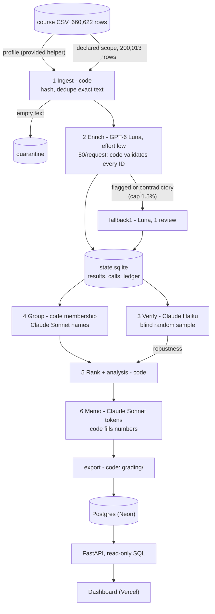

# Spotify Insight Pipeline (MBA 290T Assignment 5)

A staged program that turns 200,013 Spotify Google Play reviews into a ranked list of product issues and a
decision memo. Code ingests and profiles the course CSV and sends each distinct review text once, at most 50 per
request, to GPT-6 Luna (effort low, the setup chosen on the golden 50) for the contract labels. Claude Haiku
re-labels a declared random sample blind. Code groups complaints into issues (Claude Sonnet only names them), ranks
them, and Claude Sonnet writes the memo from saved aggregates while code fills in every number. Every handoff is a
saved file or SQLite row, every model call is logged with tokens and cost, and a stopped run resumes without
re-sending finished reviews. A Postgres database, a read-only FastAPI backend and a dashboard serve the results.

## At a glance

| | |
|---|---|
| Recommendation | **Usability: ad interruptions, shuffle/repeat/queue malfunctions and navigation** (provisional; [below](#recommendation)) |
| Live dashboard | https://spotify-review-insights-iota.vercel.app (public, read-only, **no login**) |
| Scope | Declared 200,013-row scope ([Scope](#scope)); the full 660,622-row file is ingested and profiled |
| Coverage | 200,000 classified, 13 empty texts quarantined, 0 unfinished ([run_summary.json](runs/final-200k-v2/run_summary.json)) |
| Course checker | `pass`, 0 issues, coverage candidate 1.0 ([self-check.json](runs/final-200k-v2/self-check.json)) |
| Setup choice | Three candidates labelled the golden 50; the predeclared rule picked Luna effort low (all three labels correct 54%, against 48% and 46%); the final run uses its exact configuration ([Models](#models-and-provenance)) |
| Golden 50 (Eason's labels) | Final run: topic 78%, intent 76%, severity 74% exact (MAE 0.26) ([error_analysis.md](evals/golden/error_analysis.md)) |
| Blind verifier, 2,000 reviews | topic 82%, intent 92%, severity 78% exact ([report.json](runs/final-200k-v2/verification/report.json)) |
| Evidence quotes | 100% exact substrings; a blind judge finds 89% of sampled final-run quotes support all three labels ([quote_support/report.md](evals/quote_support/report.md)) |
| Spend | $4.702001 billed API for the whole project, $2.421043 of it the final run (settled $2.323945 plus $0.097098 reserved for 17 calls of unknown outcome) ([project_spend.json](cost/project_spend.json)); Claude roles on Claude Pro ($1.9607 API-equivalent for the final run, not billed) |
| Final run | [`runs/final-200k-v2`](runs/final-200k-v2/): 4 invocations, 9,389.902 s; grading export in [`grading/`](runs/final-200k-v2/grading/). A first final run with a superseded setting is kept in [`runs/final-200k`](runs/final-200k/) |

## Recommendation

From [runs/final-200k-v2/memo.md](runs/final-200k-v2/memo.md) (the model writes tokens, code fills every number; C## IDs
are in [claims.csv](runs/final-200k-v2/claims.csv), A##/T## IDs in [memo_tokens.csv](runs/final-200k-v2/memo_tokens.csv)).
Put next quarter's effort into **usability**: ad interruptions (`usability.ads`: severity sum 23,235 (C10) across
11,233 complaints (C09)), shuffle, repeat and queue malfunctions (`usability.library`: 16,888 (C18) across 5,685 (C17))
and navigation and layout (`usability.navigation`: 7,795 (C30) across 3,168 (C29)). Usability has the highest baseline
priority of the four decision areas, severity sum 52,983 (A05), narrowly ahead of billing/support 52,551 (A08) and
playback/performance 48,060 (A11), and the highest share of complaints, 24.3% (T19) against 19.7% (T22), with
non-overlapping intervals. The memo calls the call **provisional**: on the 2,000-review verification sample the
verifier's labels put playback/performance first, 758 (T46) against usability 747 (T47) and billing/support 660 (T48);
and billing/support's share of reviews grew the most, +10.2 pp (T12), so a hedge action covers its Premium-only
restrictions issue ([memo summary](#decision-memo)).

**Why not Premium-only restrictions?** `billing.premium_only` is still the largest single issue in a decision area
(severity sum 46,246 (C06), rank 2 behind the catch-all `other.general`), and an earlier final run made with a
superseded setting recommended billing/support. The question asks for an area, though, and usability's severity is
spread over three issues whose total is higher; with the final setup, fewer free-tier complaints that never name
Premium are filed as premium-only. The gap is small (0.8%), so the memo hedges toward the Premium-only issue and calls
its call provisional ([why the two runs differ](#results)).

## Verify in 3 commands

No API key and no install: the checker, the rank check and the calculator use only the Python 3.12 standard
library. The course dataset is git-ignored; download the course ZIP (the "complete course dataset ZIP" on the
[course page](https://haas-ai-classes-fall-26.vercel.app/assignment5.html)) and unzip it into the expected folder:

```bash
curl -LO https://haas-ai-classes-fall-26.vercel.app/capstone/insight-pipeline/spotify-insight-dataset.zip
unzip spotify-insight-dataset.zip -d "Final Assignment - Spotify Reviews Dataset"
D="Final Assignment - Spotify Reviews Dataset"
# 1. Course checker on the declared scope -> "status": "pass", "issue_counts": {}, coverage candidate 1.0
python3 scripts/make_analysis_subset.py   # data/analysis_200k.csv, SHA-256 3c023c9d... (data/analysis_200k.manifest.json)
python3 "$D/check_submission.py" reference --full "$D/spotify_reviews_18months.csv" \
    --analysis data/analysis_200k.csv --out /tmp/ref.json
python3 "$D/check_submission.py" check --reference /tmp/ref.json --submission runs/final-200k-v2/grading --out /tmp/check.json
# 2. Ranking rebuilt from grading/ with no model call -> "identical": true, "issues": 22
python3 -m insight rank --run-dir runs/final-200k-v2 --check
# 3. Offline cost replay, no state database -> spend to date $4.702001 over 17 run directories
python3 cost/calculator.py replay --out-dir /tmp/calc
```

The checker report carries `reference_sha256` `363b06ce...`, as in the saved `self-check.json`. Side effects: the
subset script and the rank check refresh a timestamp in their manifest and `rank_check.json`; plain
`python3 cost/calculator.py` regenerates the committed `cost/report.md`, `report.json` and `project_spend.json`.

## Rubric map

| # | Rubric item | Evidence |
|---|---|---|
| D1 | Accessible code, setup, artifacts | Public repo; [Verify in 3 commands](#verify-in-3-commands); [How to run](#how-to-run); blank `.env.example`; [evidence index](#where-to-find-everything) |
| D2 | Architecture, shared schema, provenance | [Architecture](#architecture) and [docs/architecture.md](docs/architecture.md); [docs/labels.md](docs/labels.md); `label_config` on every record; [Models and provenance](#models-and-provenance) |
| D3 | Memo numbers trace to calculations | [memo.md](runs/final-200k-v2/memo.md): 40 claims in [claims.csv](runs/final-200k-v2/claims.csv), 128 tokens with source files in [memo_tokens.csv](runs/final-200k-v2/memo_tokens.csv); rechecked by the course checker and in SQL |
| D4 | Recommendation, alternatives, limitations | Memo: 4 actions, what would change the call, 3 alternatives, code-written limitations ([summary](#decision-memo)) |
| T1 | 50 human labels, comparison, error analysis | [golden_50_labeled.csv](evals/golden/golden_50_labeled.csv); 3 candidate setups and the final run scored; [error_analysis.md](evals/golden/error_analysis.md); quote support checked ([report](evals/quote_support/report.md)) |
| T2 | Verification, planted error, injection | Haiku blind on 2,000, [762 disagreements analysed](evals/verification/disagreement_analysis.md); planted error `detected`; injection 8/8 ([Evaluation](#evaluation)) |
| T3 | Pilot, calculator, retry/spend/recovery | Pilot cold $0.001698 / 177.3 s, warm 0 calls; replay reproduces $4.702001; live budget drill; retries reconciled ([Cost](#cost-and-spend-controls)) |
| W1 | Full ingestion, coverage, classification | Full file profiled with the provided helper ([ingestion.json](runs/final-200k-v2/grading/ingestion.json)); 200,000 / 13 / 0; checker `pass` |
| W2 | Staged program, bounded calls, resume | `python -m insight run --input <csv>`; at most 50 reviews/request; [recorded SIGINT and resume](#interruption-and-resume); [fresh-input demonstration](#fresh-input-demonstration) |
| W3 | Reproducible ranking, deployed dashboard | Rank check identical, 22 issues ([rank_check.json](runs/final-200k-v2/rank_check.json)); [Dashboard](#dashboard) |

## Results

Completed means a valid label was saved. Measured figures and estimates are kept apart.

| Final run (`runs/final-200k-v2`) | Value | Source |
|---|---|---|
| Rows | 660,622 profiled; 200,013 in scope; 152,363 distinct texts sent to the model | `ingestion.json`, `run_summary.json` |
| Completed / quarantined / unfinished | 200,000 (150,078 primary, 2,285 fallback1, 47,637 exact-text reuses) / 13 empty texts / 0; 17,828 flagged `needs_review` | `run_summary.json` |
| Ranking | 22 issues from 91,268 complaint and cancellation records; top three `other.general` 54,364, `billing.premium_only` 46,246, `usability.ads` 23,235 | `ranking.csv` |
| Verifier sample | 2,000 texts: topic 1,635, intent 1,830, severity exact 1,565, sentiment within 0.5 1,980; 762 differ on at least one field | `verification/report.json` |
| Model calls | 5,420 attempts: enrich 5,366 (3,081 primary, 2,285 fallback1), verify 40, group 10, memo 4 | `grading/calls.jsonl.gz` |
| Wall clock | 9,389.902 s (about 2.6 h) over 4 invocations: initial 199.8 s (interrupted), resume 9,012.7 s, then 2 memo regenerations without enrichment ([post-run corrections](docs/post_run_corrections.md)) | `cost/refreshes/final_200k_v2.json` |
| Workers and caps | 16 workers in the two enrichment invocations, 4 afterwards; per-run cap $4.00, 0 denials; fallback1 cap 2,285 texts (1.5%), 12,664 staged, 2,285 routed, the rest kept their label with `needs_review` | `invocations/*.json`, `cost/report.md` |

### Decision memo

Summary of [memo.md](runs/final-200k-v2/memo.md) (generated in `run-20261015T033337.582Z-bf5d`, valid on its first
attempt, no validation problems in `memo.json`).

- **Next-quarter actions**: (1) test shorter or less frequent ad breaks, watching the ad issue's complaint count (C09)
  and severity sum (C10); (2) audit and fix shuffle, repeat and queue logic (C18); (3) simplify or test reverting recent
  navigation changes (C29, C30); (4) hedge: clearer in-app explanation of the free-tier limits behind the Premium-only
  restrictions issue (C05, C06), because billing/support's share of reviews grew +10.2 pp (T12).
- **What would change the call**: the verifier's ordering (playback/performance 758 (T46) ahead of usability 747 (T47))
  holding on a larger verified sample; usability's share of reviews, which fell from 11.1% (T16) to 10.0% (T17),
  turning to outgrow billing/support's; and a human audit of the 2,456 (T56) premium-only records without a payment
  word, which could weaken billing/support as the alternative.
- **Alternatives**: billing/support (52,551 (A08); the largest single decision-area issue, Premium-only restrictions,
  46,246 (C06), and the largest growth, from 3.8% (T10) to 13.9% (T11) of reviews); playback/performance (48,060 (A11);
  share of reviews fell -4.8 pp (T15), but first under the verifier's labels); access/onboarding (smallest, 11,300 (A17)).
- **Representative reviews the memo cites** (exact quotes, from its evidence pack): `usability.ads` `16c47c30-...`
  (romanized Hindi: the app runs ads and asks for money more often than a beggar asks twice) and `59d1e2cd-...` ("Tooo many adds");
  `usability.library` `3a8d3202-...` ("I spend hours creating a Playlist and when I go to play the list it plays
  random stupid songs") and `ea18965a-...` ("YOU CAN'T EVEN REPEAT SONGS?????"). Full IDs and quotes per issue are in
  the memo's "Representative evidence" section.
- **Limitations stated in the memo**: the verifier disagreement makes the call provisional; 29.7% (A19) of complaints
  are general/unspecified and allocated to no decision area; the 460,609 out-of-scope reviews were ingested but not
  classified, while within scope 13 empty texts are quarantined, 0 are unfinished and 17,828 completed records carry
  `needs_review`; the premium-only upper-bound sensitivity (without the
  2,456 records that never mention Premium or payment, billing/support's severity sum would fall from 52,551 to 45,268
  (T58), [premium_only_sensitivity.json](runs/final-200k-v2/analysis/premium_only_sensitivity.json)); self-selected
  reviews, no revenue or churn data, cancellation language is intent; shares carry sampling error.
- **Earlier memos of this run** (kept in [memo_history/](runs/final-200k-v2/memo_history/)): the first recommended
  billing/support while usability had the higher baseline priority, arguing from a count-based trend, which its own
  prompt rule does not accept as a reason to depart; code flagged it. After the rule was made explicit the second
  recommended usability but misused "within sampling error"; the validator now rejects that. Details:
  [post_run_corrections.md](docs/post_run_corrections.md).

**Trends** (same months one year apart, `runs/final-200k-v2/analysis/period_comparison.json`): billing/support's share of
reviews rose from 3.8% (T10) to 13.9% (T11); playback/performance fell -4.8 pp (T15); usability fell -1.1 pp (T18) and
access/onboarding rose +0.8 pp (T09). Denominators: 45,073 classified reviews in 2022 Jun-Oct (T03) and 82,997 in 2023
Jun-Oct (T05). The non-decision area general/unspecified rose +22.3 pp (T55). Monthly series with denominators:
`analysis/trends_monthly.csv`; spike months (2023-07 and 2023-10): `analysis/spike_months.json`.

**Baseline ranking rule** (`insight/rank.py`): complaint and cancellation records are grouped by
`issue_id = topic.subtopic`; `priority_score = severity_sum` (= complaint count x mean severity, mean rounded half-up
to 6 places); sort by score descending, then `issue_id` ascending. No model is involved.

**The two setups disagree on the top area.** The superseded effort-none run put billing/support first (severity sum
59,146 against usability 54,124) and its memo recommended billing/support. The final setup files fewer free-tier
complaints under `billing.premium_only` when Premium is not named (15,763 members against 18,016) and more generic
criticism under `other.general` (27,137 against 23,108 complaints), which follows the written rubric more literally
([disagreement analysis](evals/verification/disagreement_analysis.md), section 4). Usability and billing/support are
within 0.8% of each other on the final run, which is why the memo calls its choice provisional.

**Development runs** (real calls before the final run, final setup: pilot 100 cold and warm, checkpoint_500 with 1
worker, analysis_10000 with 8 workers; the same steps with the superseded setup, including the 1-vs-2 worker
comparison): rows, workers, billed cost, time and the estimate each step gave are in [cost/report.md](cost/report.md)
("Measured refreshes", "Scaling decision") and [docs/model_choice.md](docs/model_choice.md).

## Scope

The final run classifies a declared 200,013-row scope: the first 200,000 eligible reviews in the course's own
SHA-256 sampling order (it contains the golden 50, `cost_100`, `checkpoint_500` and `analysis_10000`) plus the 13
empty texts, which are quarantined. The assignment allows a run of at least 100,000 reviews ("What You Are
Submitting", item 3; "Definition of Done"); this run uses twice that minimum. The full 660,622-row file
is ingested and profiled with the provided helper (`grading/ingestion.json`). The other 460,609 rows are not
classified, so counts and shares describe a uniform sample (the memo shows sampling intervals). Regenerate the scope
with `python3 scripts/make_analysis_subset.py` (SHA-256 `3c023c9d...`, `data/analysis_200k.manifest.json`).

<sub>Reference only: against a reference built from the full file alone, the checker lists the 460,609 unclassified
rows as missing (`review_required`, coverage candidate 0.4422;
[self-check-vs-full-reference.json](runs/final-200k-v2/self-check-vs-full-reference.json)).</sub>

## Architecture

Six stages coordinated by code (`insight/cli.py`): models answer bounded questions; code owns accounting, validation,
arithmetic, budgets, retries and routing. Full diagram with retry paths, stage table, state and resume rules:
[docs/architecture.md](docs/architecture.md); labels and output schema: [docs/labels.md](docs/labels.md); a
five-minute spoken walkthrough with one failure end to end: [docs/walkthrough.md](docs/walkthrough.md).



Only `review_text` reaches a model (tested). Quotes are exact slices chosen by sentence number; entities are
matched by code. One result per distinct text, with `cache_source_id` on reused rows. Results are saved per batch and
never relabelled under the same `label_config`. Fallback routing starts only after every primary result is in, so
it does not depend on worker count or interruptions.

## Models and provenance

| Role | Configured alias | Exact model ID (reported) | Setting | Billing |
|---|---|---|---|---|
| Enrich, primary | `gpt-6-luna` (OpenAI Responses) | `gpt-6-luna` | effort low, Flex, 50 reviews/request, 200 output tokens per review | billed API |
| Enrich, fallback1 | `gpt-6-luna` | `gpt-6-luna` | effort low, 1 review/request, cap 1.5% of distinct texts | billed API |
| Enrich, fallback2 | `sonnet` (`claude -p`) | never routed | effort low, cap 0.25% | Claude Pro |
| Verify | `haiku` (`claude -p`) | `claude-haiku-4-5-20251001` | blind, declared 10% sample, at most 2,000 | Claude Pro |
| Group (names only) | `sonnet` (`claude -p`) | `claude-sonnet-5` | top 12 issues, 12 sampled quotes each | Claude Pro |
| Memo | `sonnet` (`claude -p`) | `claude-sonnet-5` | aggregates + evidence pack, tokens only | Claude Pro |

Each role's model is fixed in `config/pipeline.toml`, and `insight/cli.py` refuses to start if a configured
provider/model has no dated price row in `cost/rates.csv`. `grading/calls.jsonl.gz` keeps the configured alias in
`model` and the exact ID the provider reported in `model_reported`; `cost/report.md` shows both side by side. Every
record carries `label_config` (model, effort, prompt, schema, output cap, fallback caps):
`gpt-6-luna@low>gpt-6-luna@low(1.5%)>sonnet@low(0.25%)|enrich-v2|schema-v2|cfg-52c5333247`. Each Claude stage has a
stage config `<alias>@<effort>|<stage>-v1|cfg-<hash>` (`stage_configs` in `run_summary.json`): `<stage>-v1` is the
version of that key format, not of the prompt file. The prompt is identified by its SHA-256 inside `cfg-<hash>`, so
`verify-v1` uses `prompts/verify_v2.md` and `memo-v1` uses `prompts/memo_v2.md` (`insight/config.py`, `stage_config`).

**Why these models** ([docs/model_choice.md](docs/model_choice.md)). Batched Luna is the only measured option that
fits the $9.00 project cap and the deadline: the Decisions API allowed 50 requests per day (`decisions` and `hybrid`
backends are built and tested, but off), and Jev was not run ($5 minimum purchase against a $10 budget). Three
candidate setups then labelled the golden 50 (Luna effort none, Luna effort low, Decisions), and the rule written in
the plan before any label existed (best "all three correct" within the cost cap) picked effort low: 54% against 46%
and 48%. The golden labels were finished after a first final run with effort none, so that run was superseded
(`runs/final-200k`, kept as evidence and counted in spend) and the final run used the winner's exact `label_config`.
No prompt, label or threshold was changed because of golden results. Re-run, the same configuration scored 48% all
three on the golden 50 (the candidate run sent the 50 texts in one request, the final run across 39); on 50 cases the
setups are within noise of each other, and the golden scores of the final run carry a small selection bias
(`evals/golden/error_analysis.md`).

## Cost and spend controls

Full report: [cost/report.md](cost/report.md) (offline replay, projections and scaling decision); calculator:
[cost/calculator.py](cost/calculator.py) and its guide [cost/README.md](cost/README.md); dated prices with source links:
[cost/rates.csv](cost/rates.csv); projection inputs and controls: [cost/assumptions.json](cost/assumptions.json);
measured pilot evidence: [pilot_runs.json](cost/pilot_runs.json), [pilot_calls.jsonl](cost/pilot_calls.jsonl),
[usage.csv](cost/usage.csv).

- **100-review pilot** (`cost/report.md`, "Measured 100-review pilot"), final setup: cold, 100 of 100 completed with 3
  enrichment calls in 177.3 s, $0.001698 billed; warm rerun in the same directory, 0 calls, 100 result-cache hits,
  0.044 s. The first pilot with the superseded setup is in `cost/experiments/pilot-effort-none/`.
- **Billed spend**: $4.702001 over 22,977 billed-provider calls in 17 run directories against the $9.00 project cap
  (settled $4.604903 plus $0.097098 reserved for the final run's 17 unknown-outcome calls): the final run $2.421043,
  the superseded first final run $2.019246, the two analysis_10000 runs $0.128644 and $0.096326, the other thirteen
  runs $0.036742 together (including the $0.001022 fresh-input rehearsal) (per run in `cost/project_spend.json`). Each call is priced as its reported usage x
  `rates.csv`, so the total is reproduced offline without the git-ignored run databases. Billed OpenAI spend can be
  reconciled against the account's usage page; no such reconciliation figure is recorded in this repository.
- **Claude Pro**: the Claude roles run through `claude -p` on a flat monthly Claude Pro subscription. That fee is
  not included in per-call billed spend; the calculator prices Pro calls at Anthropic API rates as
  "API-equivalent" ($1.9607 for the final run) and never adds it to billed spend.
- **Retries, final run**: 1 HTTP 429, 1 server error, 16 timeouts (900 s on Flex) and 1 connection error, all retried
  with backoff; the 17 calls whose outcome is unknown keep their reservation in the spend because the provider may
  have billed them. 14 outputs were partly valid (some reviews' labels rejected, the rest saved) and their 14 retry
  tasks made 14 attempts; 0 unfinished (footnote under "Retries" in [cost/report.md](cost/report.md)).
- **Controls**: per-run `--budget-usd` cap with worst-case reservations; project cap `run.project_cap_usd = 9.00`
  over every `runs/**/state.sqlite` (unreadable fails closed); prepaid credit, auto-recharge off; bounded backoff
  with jitter, one invalid-output retry, a circuit breaker; SDK retries off, so every attempt is priced and logged.
  A Claude Pro plan limit or an exhausted OpenAI credit stops the run (resume later) instead of degrading it.
- **Live budget drill** (`runs/live-budget-drill`): with `--budget-usd 0.005` the run stopped with `budget_cap`
  after $0.002979, 353 of 500 IDs saved; the same command under `--budget-usd 0.05` resumed and completed all 500
  (`run_summary.json`, `runs/drill_console.log`).
- **Scaling decision** (`cost/report.md`): the estimate was refreshed after the pilot, 500 and 10,000-review runs of
  the final setup; the last step before the final run gave $2.32 to $4.55 for the declared scope, and the run billed
  $2.323945. The full 660,622-row file would cost $7.39 to $15.06 (estimate, not run).

## Evaluation

Details and commands: [evals/README.md](evals/README.md).

- **Golden 50** (labelled by Eason, never ingested or used in prompts): final run topic 78%, intent 76%, severity
  exact 74% (MAE 0.26), sentiment within 0.5 for 88%; 0 multi-label cases; 6 flagged `needs_review` by the human; every
  quote an exact substring. 7 of the 12 intent misses are a documented convention difference (Eason labels "reports a
  problem and asks for a fix" as request); excluding them, intent agreement is 38/43 = 88%
  ([error_analysis.md](evals/golden/error_analysis.md), [every disagreement](evals/golden/results_disagreements.md)).
  The golden set chose the setup (section 1 of the error analysis), so these scores carry a small selection bias; no
  fresh human-labelled set was added after the choice.
- **Do the quotes support the labels?** A blind judge (Claude Haiku, Claude Pro) read each review with the final run's
  quote and three labels: 89% of 500 sampled final-run quotes support all three labels (topic 92%, intent 97%,
  severity 97%), and 98% of the final run's golden quotes. Code, not a model, compared the golden quotes with Eason's
  evidence sentences: the model quoted the same sentence in 47 of 50 reviews. Eason's golden labels never reach the
  judge; a first version that also sent them as calibration items was withdrawn and re-run without them
  ([quote_support/report.md](evals/quote_support/report.md), every rejected quote listed).
- **Independent verification**: Claude Haiku labels a declared random sample blind (2,000 reviews, figures in
  [Results](#results)). The 762 disagreements are counted by field and direction in
  [disagreement_analysis.md](evals/verification/disagreement_analysis.md): 570 differ on one field, the largest
  pattern is severity 3 -> 4 (163), and the verifier moves 41 of 203 sampled premium-only texts to another topic. The
  inspected cases there are the AI assistant's reading, not human labels.
- **Run-to-run reproducibility**: the same 500 reviews with 1 and 2 workers agree on topic 482/500, intent 489/500,
  severity 484/500 and all three 466/500 (effort-none setup); the routing code gives identical labels for identical
  answers (`tests/test_pipeline.py::test_two_workers_give_identical_labels`), so the differences come from the model.
- **Planted wrong label**: `python -m insight planted-error` changed review `00015590-...` in a test copy from
  catalog / praise / 1 to billing / complaint / 5; the saved verifier label disagrees on all four fields, `detected`
  ([planted_error.json](runs/final-200k-v2/evals/planted_error.json)).
- **Prompt injection**: 8 synthetic cases in their own run directory, 8 of 8 passed with the live enricher
  ([synthetic_check.json](runs/live-synthetic-injection/evals/synthetic_check.json)).
- **Trace**: one review of the recommended area's largest issue followed from source row to enrichment, verification
  (the verifier agrees on every field), membership, ranking and the memo claims C09-C12, plus one ambiguous case
  routed for a fallback decision and saved with `needs_review` ([docs/trace_example.md](docs/trace_example.md)).
- **Failures found and fixed live**: the Claude Pro session limit was classed as a transient error, so a checkpoint
  run's verify, group and memo degraded silently; it now stops the run, and the run was resumed with no enrichment
  calls ([walkthrough](docs/walkthrough.md)). The final run's memo was regenerated twice from saved labels
  ([post-run corrections](docs/post_run_corrections.md)).

### Interruption and resume

In the initial invocation the recorder (`scripts/record_session.py`) sent a real SIGINT after 180 s of saved
progress. The run finished its in-flight batches and stopped at 199.8 s (exit 130) with 36,780 IDs saved
(`grading/checkpoint_before.json`). The same command resumed under phase `resume` with 145,563 pending distinct texts
and completed all 200,000 in 9,012.7 s (`grading/checkpoint_after.json`, `run_summary.json` `history`). Recordings:
[1-initial-interrupted.cast](runs/final-200k-v2/recording/1-initial-interrupted.cast) /
[.txt](runs/final-200k-v2/recording/1-initial-interrupted.txt) and [2-resume.cast](runs/final-200k-v2/recording/2-resume.cast) /
[.txt](runs/final-200k-v2/recording/2-resume.txt); console logs [final_v2_initial_console.log](runs/final_v2_initial_console.log)
and [final_v2_resume_console.log](runs/final_v2_resume_console.log). They play in the dashboard's Run & cost tab or with
`asciinema play -i 2 <file>.cast` (add `-s 10` for the 2.5-hour resume). The offline demo repeats the drill on 500
reviews (SIGINT, exit 130, resume, warm rerun with 0 calls, fault and budget drills;
[runs/offline-demo-transcript.txt](runs/offline-demo-transcript.txt)).

### Fresh-input demonstration

`./scripts/fresh_input_demo.sh <any.csv>` runs every stage on a file the pipeline has never seen and checks the
result: it prepares the CSV (only a review-text column is required; missing source columns are filled blank and
reported, source values are never edited, `scripts/prepare_fresh_input.py`), runs the pipeline with an interruption
after the first saved request and a resume when the file has more than 50 distinct texts, runs the course checker
against a reference built from the same file, rebuilds the ranking without a model and prints a summary. `--offline`
does the same with stub models and no key. Rehearsal on 2026-10-15 with 60 real reviews outside the declared scope
that no run had labelled, with two source columns left out ([evals/fresh_input/rehearsal_60.csv](evals/fresh_input/rehearsal_60.csv)):
60 completed after a stop at 56 and a resume, checker `pass` with coverage 1.0, rank check identical, billed $0.001022
([console log](runs/fresh_demo_rehearsal_console.log), run directory `runs/fresh-rehearsal_60-20261015T034611Z/`).

## Dashboard

- **URL**: https://spotify-review-insights-iota.vercel.app. Public and read-only; no account or login. The first
  request after an idle period can take a few seconds (serverless cold start).
- **What it shows**: a headline with the recommendation on first load; tabs Overview, AI recommendation, Issue
  ranking, Trends, Evaluation (golden set with the candidate comparison, verifier, quote support, planted error,
  injection, checker), Run & cost (plays both recordings) and Review lookup (per-review trace). Every memo number shows
  what it measures and its source file.
- **Consistency**: `/api/consistency` recomputes the ranking, the 40 claims and the memo's 52 area, scope and
  trend tokens (selection in `web/api/index.py`, `_token_checks`) in SQL at request time; a check on 2026-10-17 UTC found
  all of them matching.
- **API**: GET-only JSON, including `/api/health`, `/api/overview`, `/api/ranking`, `/api/recommendation`,
  `/api/evals`, `/api/reviews/{review_id}` and `/api/consistency`; interactive Swagger docs at `/api/docs` (also `/docs`).
- **Stack**: Vercel (static `web/public/`, FastAPI `web/api/index.py` as the SELECT-only role `dashboard_ro`) and
  Neon Postgres (`web/schema.sql`), loaded by `web/load_db.py`, which checks row counts, the SQL-recomputed ranking
  and every claim. No model is called. Local preview without Postgres: `web/load_db.py --database-url
  sqlite:///web/local.db`, then `web/dev_server.py`.

## How to run

```bash
python3.12 -m venv .venv && .venv/bin/pip install -r requirements.txt
./scripts/offline_demo.sh                 # offline stub run on checkpoint_500: SIGINT, resume, warm rerun, checker, drills
.venv/bin/python -m unittest discover -s tests   # 106 tests, all offline
./scripts/fresh_input_demo.sh evals/fresh_input/rehearsal_60.csv --offline   # every stage on a fresh CSV, no key
```

Live (billed) steps, for the student: keys go in a git-ignored `.env` (see `.env.example`); without `--allow-paid`
the program refuses live calls. `./scripts/live.sh` runs `pilot`, `checkpoint500`, `budget-drill`, `injection`,
`golden-candidates`, `analysis10k`, `final-initial` (recorded) and `final-resume`, then `finalize` (offline: checker
against both references, rank check, planted error, trace, golden scoring, disagreement counts, calculator refresh),
`quote-support` (Claude Pro), `load-db` and `fresh-demo <csv>`.

## Where to find everything

| What | Files |
|---|---|
| Grading export (contract file names; the two JSONL files are gzipped) | [`runs/final-200k-v2/grading/`](runs/final-200k-v2/grading/): run.json, ingestion.json, records.jsonl.gz, calls.jsonl.gz, checkpoint_before.json, checkpoint_after.json, membership.csv, ranking.csv, claims.csv |
| Memo | [memo.md](runs/final-200k-v2/memo.md), [memo.json](runs/final-200k-v2/memo.json), [claims.csv](runs/final-200k-v2/claims.csv), [memo_tokens.csv](runs/final-200k-v2/memo_tokens.csv), [memo_history/](runs/final-200k-v2/memo_history/) |
| Records | [enriched.jsonl.gz](runs/final-200k-v2/enriched.jsonl.gz), [quarantine.jsonl](runs/final-200k-v2/quarantine.jsonl) |
| Ranking and analysis | [ranking.csv](runs/final-200k-v2/ranking.csv), [aggregates.csv](runs/final-200k-v2/aggregates.csv), [issues.json](runs/final-200k-v2/issues.json), [area_rollup.json](runs/final-200k-v2/area_rollup.json), [analysis/](runs/final-200k-v2/analysis/) |
| Run evidence | [ingestion_report.json](runs/final-200k-v2/ingestion_report.json), [data_manifest.json](runs/final-200k-v2/data_manifest.json), [run_summary.json](runs/final-200k-v2/run_summary.json), [run_log.jsonl](runs/final-200k-v2/run_log.jsonl), [invocations/](runs/final-200k-v2/invocations/), [checkpoints/](runs/final-200k-v2/checkpoints/), [recording/](runs/final-200k-v2/recording/) |
| Checks | [self-check.json](runs/final-200k-v2/self-check.json), [rank_check.json](runs/final-200k-v2/rank_check.json), [verification/](runs/final-200k-v2/verification/), [planted_error.json](runs/final-200k-v2/evals/planted_error.json), [evals/](evals/) |
| Cost | [cost/report.md](cost/report.md), [cost/README.md](cost/README.md), [cost/project_spend.json](cost/project_spend.json) |
| Design docs | [architecture](docs/architecture.md), [labels](docs/labels.md), [model choice](docs/model_choice.md), [walkthrough](docs/walkthrough.md), [trace](docs/trace_example.md), [post-run corrections](docs/post_run_corrections.md) |
| Superseded first final run | [`runs/final-200k/`](runs/final-200k/) (effort none; its own grading export, memo and checks; [why it is superseded](runs/final-200k/SUPERSEDED.md)) |

**Final-run state database (not in git).** `runs/final-200k-v2/state.sqlite` is the asset
`final-200k-v2-state.sqlite.gz` of the release
https://github.com/easonhanyc/mba290t-Multi-Agent-Large-Data-Processing-Pipeline/releases/tag/final-200k-v2 and holds
all 4 invocations. The three verification commands do not need it. It backs the per-call log, the `invocations`
table and the earlier memo outputs (`stage_cache`), and `python -m insight trace` reads it. The superseded run's
database is the asset of the release `final-200k`.

```bash
gunzip -c final-200k-v2-state.sqlite.gz > runs/final-200k-v2/state.sqlite
shasum -a 256 runs/final-200k-v2/state.sqlite   # 3d838b994396bd1b844276aff1fee39c995ae48be85800ab48e800d60dd82420
```

## Limitations

- Reviews are a self-selected, historical sample of public Google Play reviews, not a customer population, with
  no revenue, plan-tier or churn data; cancellation language is not a confirmed cancellation. Shares carry sampling
  error (95% intervals in the memo).
- The recommended area depends on the labeller. Usability leads billing/support by 432 severity points (0.8%) on the
  final run; on the 2,000-review verification sample the enricher's labels put billing/support first and the
  verifier's put playback/performance first (`runs/final-200k-v2/analysis/robustness.json`); and the superseded
  effort-none run put billing/support first. The memo's call is provisional for that reason. 29.7% of complaints name
  no specific area.
- Model answers are not deterministic (34 of 500 reviews differed between two runs; the same configuration scored 54%
  and 48% all three on the golden 50), so read small differences in counts with care. The verifier is another model,
  not ground truth, and the golden set has 50 cases: a diagnostic, not a precise accuracy estimate. It also chose the
  enrichment setup, so its scores for the final run carry a small selection bias.
- Star ratings are never used as labels. 159,701 rows of the full file have no app version. The first and last
  months are partial: rows run from 2022-05-17 up to 2023-11-17, and the last review is dated 2023-11-15
  (`Final Assignment - Spotify Reviews Dataset/README.md`).
- The worked examples in `docs/labels.md` were drafted with the AI assistant from development rows 101-500 and
  reviewed by Eason; they illustrate the rubric and are not part of the golden evaluation.

## Data source and license

Course extract of "3.4 Million Spotify Google Store Reviews" by BwandoWando, Kaggle, version 2 (published
2023-11-17), publisher-listed license CC0: Public Domain:
https://www.kaggle.com/datasets/bwandowando/3-4-million-spotify-google-store-reviews (source archive SHA-256
`7b351f41fef9de9d8cba07ac40a300d20fd605ff0298a1885df0dbf0d66b3cbc`). The course removed the row index, author names
and author IDs. Course ZIP: https://haas-ai-classes-fall-26.vercel.app/capstone/insight-pipeline/spotify-insight-dataset.zip.
Full CSV SHA-256 `1fc85de68a304dd8978b537cfa58793d5f41cbaf417fa32cb53899f83a2fcef6`; `checkpoint_500.csv` SHA-256
`a94e31663ee7b7eaa77e23b7a8425b530cc0c866ed5e714953172a0afef6a12f` (`Final Assignment - Spotify Reviews
Dataset/manifest.json`).

## Layout

```
insight/              pipeline package (python -m insight); providers/ = API and claude -p adapters; stub.py = offline server
config/pipeline.toml  every setting; label-affecting ones are hashed into label_config
prompts/ cost/ evals/ docs/ web/ tests/ scripts/: prompts, calculator, evaluations, docs, dashboard, tests, scripts
runs/                 final-200k-v2 (final), final-200k (superseded), live-*, probe-*, golden-*, pilot100-2026101*,
                      fresh-rehearsal_60-* made real calls; offline-stub-*, pilot100-offline-stub-* and *preflight*
                      made none; *_console.log = live console output
data/                 declared-scope manifest and probe_dev_5.csv; other CSVs are git-ignored and regenerable
```

Dependencies: Python 3.12.14; `openai==3.23.0`, `anthropic==1.11.0`, `typesafe-sdk==0.7.2` (`requirements.txt`);
`fastapi==0.115.6`, `psycopg[binary]==3.2.3` (`web/requirements.txt`).
