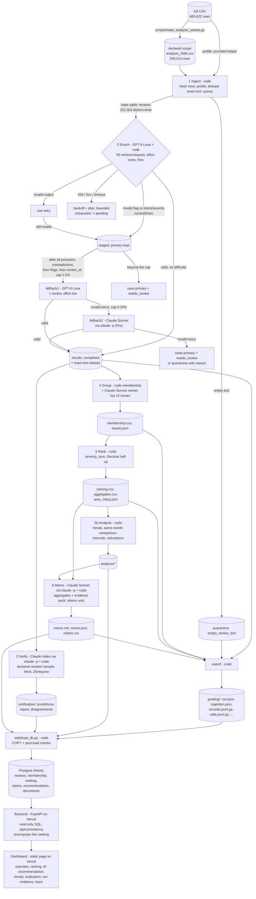

# Architecture

Six stages coordinated by code (`insight/cli.py`), followed by a database, a backend and a dashboard.
Models answer bounded questions; code owns record accounting, validation, arithmetic, budgets, retries
and every decision about what happens next.

## Stages

| # | Stage | Owner | Input | Output | Failure behaviour | Stop condition |
|---|---|---|---|---|---|---|
| 1 | Ingest | code | analysis CSV (+ `--full` source) | `reviews` table, `ingestion_report.json`, `ingestion.json` (provided helper, full file), `data_manifest.json` | malformed CSV, or an analysis row that differs from the full file, aborts before any model call | all rows read |
| 2 | Enrich | `gpt-6-luna` (effort none, Flex) + code; capped fallbacks `gpt-6-luna` (effort low) and Claude Sonnet | pending distinct texts, at most 50 per request | `results` rows saved per batch; `staged` rows awaiting a fallback decision | every returned ID validated; invalid items retried once, then staged/quarantined; transient errors: backoff, re-queued once, then pending | queue empty, budget cap, project cap, circuit breaker, Ctrl-C |
| 3 | Verify | Claude Haiku (`claude -p`, Pro) + code | declared random sample of distinct completed texts (10%, at most 2,000) | `verification/*` | invalid items retried once, then recorded as failed | sample done or stop |
| 4 | Group | code (membership) + Claude Sonnet (names only) | completed complaint/cancellation records | `membership.csv`, `issues.json` | naming failure keeps the taxonomy name | top 12 issues named |
| 5 | Rank | code | records + membership | `ranking.csv`, `aggregates.csv`, `area_rollup.json` | inconsistent membership raises | always completes |
| 5b | Analysis | code | records + source metadata | `analysis/*` | n/a (arithmetic) | always completes |
| 6 | Memo | Claude Sonnet (`claude -p`, Pro) + code | top issues, area roll-up, trend and robustness figures, scope figures, evidence pack | `memo.md`, `claims.csv`, `memo.json` | invalid twice: deterministic template memo, marked | one memo |
| - | Load / serve | code | the run's exported files | Postgres tables; JSON API; dashboard | post-load checks (row counts, SQL ranking = saved ranking, claims) fail the load | one load per final run |

## Who decides the next action

A fixed workflow, not an autonomous agent. Code routes every review: primary result -> validate -> save,
retry once, stage for a capped fallback, or quarantine. Staged reviews wait until every primary result is
in; code then orders them (no usable primary first, then intent/severity contradictions, then the model's
own ambiguity flag, then review_id) and routes the first ones up to the cap, so the selection does not
depend on worker count, completion order or interruptions. Models never choose tools, never see other
stages' outputs except the bounded inputs listed above, and never write numbers into the memo (claim tokens
only). The decision points that matter (difficulty routing, fallback caps, retries, budget) are explicit
code rules.

## Why each model call exists

- **GPT-6 Luna, enrich** (50 reviews per request, `reasoning.effort = none`, Flex tier): the fixed-label
  judgments (issue/topic, intent, severity, sentiment level, which sentence is the evidence, an ambiguity
  flag). Chosen over Jev on measured golden-set quality and cost (see `docs/model_choice.md`).
- **GPT-6 Luna, fallback1** (one review, `effort = low`): a second, more careful read of the reviews the
  primary pass flagged or contradicted itself on, capped at 1.5% of distinct texts.
- **Claude Sonnet, fallback2**: only when fallback1 output is invalid twice; capped at 0.25%.
- **Claude Haiku, verify**: an independent second opinion from a different model family, blind to the
  enricher, on a declared random sample.
- **Claude Sonnet, group**: human-readable issue names from at most 8 quotes per issue. Membership is code.
- **Claude Sonnet, memo**: prose from saved aggregates. Code checks every token, review ID and area.

What code does instead of a model: parsing, hashing, duplicate detection, the pending queue, quote
extraction (exact slices), entity matching, schema and consistency validation, grouping, ranking
arithmetic, trends and intervals, claim numbers, budgets, retries, exports, database load and every API answer.

Claude roles run through `claude -p` (Claude Code headless) under the Claude Pro subscription: no per-call
API bill. The CLI runs in an empty temporary directory with all tools, MCP servers and settings files
disabled, our system prompt and a JSON schema; `ANTHROPIC_API_KEY` is stripped so it cannot switch to API
billing. Token usage and exact model IDs are logged like any other call; the calculator shows their
API-equivalent price separately from billed spend.

## State, caching and resume

- One SQLite file per run directory (`state.sqlite`, WAL). Results are written only by the orchestrator
  thread, one review plus its exact-text aliases per transaction, with insert-or-ignore: a completed record
  is never relabelled or double-counted under the same `label_config`.
- Each attempt is written as `dispatched` before the request is sent and settled afterwards. A killed
  process leaves `dispatched` rows that the next run marks `unknown`; their reserved cost keeps counting
  against the budget.
- Exact-text reuse: one model result per distinct text; other rows get `cache_source_id` pointing directly
  at that original. `label_config` covers model, effort, prompt and schema versions, batch size and fallback
  caps (not the processing tier or timeouts, which change price, never answers).
- Resume = run the same command on the same run directory. Only pending reviews are sent, under phase
  `resume`; completed IDs are never re-sent. Group and memo outputs are cached by their exact inputs.
- `checkpoints/<run_id>.json` snapshots completed IDs at the end of every invocation; the export uses the
  first interrupted snapshot as `checkpoint_before.json` and the latest as `checkpoint_after.json`.

## Concurrency, rate limits and spend

- One worker for the pilot; worker count for larger runs chosen from a measured 1-vs-2-worker comparison
  on the same reviews and the 10k checkpoint.
- One token-bucket limiter per provider (requests/min and tokens/min) shared by all workers.
- One spend ledger per run directory, shared by all workers. Before each attempt: reserve the worst case at
  Standard prices; refuse when spent + unknown + reserved + next reservation would exceed the cap.
- Project cap: `run.project_cap_usd` ($9.00) sums billed spend in every run directory under `runs/`; a new
  run's budget is lowered to what remains and a run is refused when nothing remains. Prepaid OpenAI credit
  with auto-recharge off is the provider-side limit.
- Transient errors: exponential backoff with full jitter, honouring `retry-after`, up to 4 attempts; N
  consecutive exhausted requests trip the circuit breaker. SDK-internal retries are disabled so every
  attempt is visible, priced and logged.

## Database, backend and dashboard

- **Database** (`web/schema.sql`, Postgres on Neon): `reviews` (the six source fields plus the final record
  for each of the 200,013 reviews in scope), `membership`, `issues`, `ranking`, `area_rollup`,
  `trends_monthly`, `claims`, `recommendation` (memo output, tokens, payload, rendered memo), `verification`,
  and `documents` (analysis outputs, evaluation results, run evidence, the interruption recording).
- **Loader** (`web/load_db.py`): reads only exported artifacts, replaces the previous load in one
  transaction (COPY on Postgres), then checks row counts, that the ranking recomputed in SQL equals
  `ranking.csv`, and that every claim equals the SQL value.
- **Backend** (`web/api/index.py`, FastAPI as a Vercel Python function): read-only SQL through a
  SELECT-only database role. `/api/consistency` recomputes the baseline ranking and every claim from the
  `reviews` and `membership` tables at request time. No model is ever called.
- **Dashboard** (`web/public/`): a static page on the same Vercel project that renders only what the API
  returns. It shows overall metrics, the issue ranking with source evidence, the AI recommendation with
  each number traced to its claim, trends, evaluations, run and cost evidence, and a per-review trace.

## Files per run directory

`state.sqlite`, `ingestion_report.json`, `ingestion.json`, `data_manifest.json`, `enriched.jsonl(.gz)`,
`quarantine.jsonl`, `verification/`, `membership.csv`, `issues.json`, `ranking.csv`, `aggregates.csv`,
`area_rollup.json`, `analysis/`, `memo.md`, `memo.json`, `claims.csv`, `run_log.jsonl`, `run_summary.json`,
`invocations/`, `checkpoints/`, `recording/` (final run), `grading/` (contract export), `evals/`.
