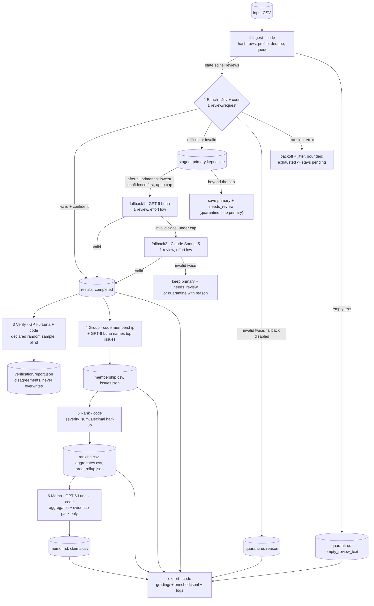

# Architecture

Six stages coordinated by code (`insight/cli.py`). Models answer bounded questions; code owns record
accounting, validation, arithmetic, budgets, retries and every decision about what happens next.

## Stages

| # | Stage | Owner | Input | Output | Failure behaviour | Stop condition |
|---|---|---|---|---|---|---|
| 1 | Ingest | code | CSV path | `reviews` table, `ingestion_report.json`, `ingestion.json` (provided helper) | malformed CSV aborts before any model call | all rows read |
| 2 | Enrich | Jev (`jev-1.13.0`) + code; capped fallbacks GPT-6 Luna, Claude Sonnet 5 | pending distinct texts | `results` rows, saved per review; `staged` rows awaiting a fallback decision | invalid output: one retry, then staged for the capped fallback (or quarantine); transient: backoff, re-queued once, then pending | queue empty, budget cap, circuit breaker, Ctrl-C |
| 3 | Verify | GPT-6 Luna (`effort=low`) + code | declared random sample of distinct completed texts | `verification/*` | invalid twice: recorded as failed verification | sample done or stop |
| 4 | Group | code (membership) + GPT-6 Luna (`effort=none`, names only) | completed complaint/cancellation records | `membership.csv`, `issues.json` | naming failure keeps the taxonomy name | top-k issues named |
| 5 | Rank | code | records + membership | `ranking.csv`, `aggregates.csv`, `area_rollup.json` | inconsistent membership raises | always completes |
| 6 | Memo | GPT-6 Luna (`effort=low`) + code | top issues, area roll-up, scope figures, evidence pack | `memo.md`, `claims.csv`, `memo.json` | invalid twice: deterministic template memo, marked | one memo |

## Who decides the next action

A fixed workflow, not an autonomous agent. Code routes every review: primary result -> validate -> save,
retry once, stage for a capped fallback, or quarantine. Staged reviews wait until every primary result is
in; code then ranks them (no usable primary first, then lowest confidence, then review_id) and routes the
first ones up to the cap, so the selection does not depend on worker count, completion order or
interruptions. Models never choose tools, never see other stages'
outputs except the bounded inputs listed above, and never write numbers into the memo (claim tokens only).
Adaptive tool use would add cost and nondeterminism without a measured quality gain here; the decision
points that matter (difficulty routing, fallback caps, retries, budget) are explicit code rules.

## Why each model call exists

- **Jev, enrich**: fixed-choice judgments (issue, intent, severity, sentiment level, evidence sentence) with
  calibrated probabilities. Confidence drives `needs_review` and the fallback route.
- **GPT-6 Luna, fallback1**: a generative reader for the reviews Jev is unsure about, with the full rubric in context.
- **Claude Sonnet 5, fallback2**: stronger model for the rare case where fallback1 output is invalid twice; capped at 1%.
- **GPT-6 Luna, verify**: an independent second opinion from a different model family, on a declared sample only.
- **GPT-6 Luna, group**: human-readable issue names from at most 8 quotes per issue. Membership is code.
- **GPT-6 Luna, memo**: prose from saved aggregates. Code checks every token, review ID and area.

What code does instead of a model: parsing, hashing, duplicate detection, the pending queue, quote
extraction (exact slices), entity matching, schema and consistency validation, grouping, ranking
arithmetic, claim numbers, budgets, retries, exports.

## State, caching and resume

- One SQLite file per run directory (`state.sqlite`, WAL). Results are written only by the orchestrator
  thread, one review plus its exact-text aliases per transaction, with insert-or-ignore: a completed record
  is never relabelled or double-counted under the same `label_config`.
- Each attempt is written as `dispatched` before the request is sent (from the worker thread) and settled
  afterwards. A killed process leaves `dispatched` rows that the next run marks `unknown`; their reserved
  cost keeps counting against the budget (a timed-out request may still be billed).
- Exact-text reuse: one model result per distinct text; other rows get `cache_source_id` pointing directly
  at that original (no chains). `label_config` covers model, effort, prompt and schema versions, thresholds
  and fallback caps, so any change forces new work.
- Resume = run the same command on the same run directory. Only pending reviews are sent, under phase
  `resume`; completed IDs are never re-sent. Staged reviews (primary answer saved, fallback decision pending)
  keep their primary answer, so a resume never repeats their primary request. Group and memo outputs are cached by their exact inputs, so a
  warm rerun makes zero model calls.
- `checkpoints/<run_id>.json` snapshots completed IDs at the end of every invocation; the export uses the
  first interrupted snapshot as `checkpoint_before.json` and the latest as `checkpoint_after.json`.

## Concurrency, rate limits and spend

- Start at one worker (`run.workers = 1`); a two-worker run on the same input gives identical labels (test).
- One token-bucket limiter per provider (requests/min and tokens/min) shared by all workers.
- One spend ledger per run directory, shared by all workers. Before each attempt: reserve
  `estimated input tokens x input price + output cap x output price`; refuse when spent + unknown + reserved
  + next reservation would exceed the cap; stop admitting work, finish in-flight requests, save, exit 3.
- Transient errors: exponential backoff with full jitter, honouring `retry-after`, up to 4 attempts; N
  consecutive exhausted requests trip the circuit breaker. SDK-internal retries are disabled so every
  attempt is visible, priced and logged.

## Files per run directory

`state.sqlite`, `ingestion_report.json`, `ingestion.json`, `enriched.jsonl`, `quarantine.jsonl`,
`verification/`, `membership.csv`, `issues.json`, `ranking.csv`, `aggregates.csv`, `area_rollup.json`,
`memo.md`, `memo.json`, `claims.csv`, `run_log.jsonl`, `run_summary.json`, `invocations/`, `checkpoints/`,
`grading/` (contract export), `evals/` (planted-error result).
