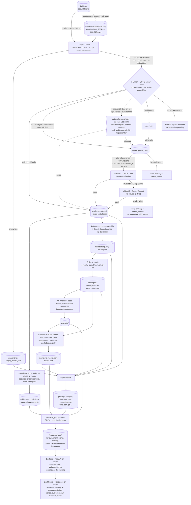

# Architecture

Six stages coordinated by code (`insight/cli.py`), followed by a database, a backend and a dashboard.
Models answer bounded questions; code owns record accounting, validation, arithmetic, budgets, retries
and every decision about what happens next.

## Stages

| # | Stage | Owner | Input | Output | Failure behaviour | Stop condition |
|---|---|---|---|---|---|---|
| 1 | Ingest | code | analysis CSV (+ `--full` source) | `reviews` table, `ingestion_report.json`, `ingestion.json` (provided helper, full file), `data_manifest.json` | malformed CSV, or an analysis row that differs from the full file, aborts before any model call | all rows read |
| 2 | Enrich | `gpt-6-luna` (effort none, Flex) + code; capped fallbacks `gpt-6-luna` (effort low) and Claude Sonnet | pending distinct texts, at most 50 per request | `results` rows saved per batch; `staged` rows awaiting a fallback decision | every returned ID validated; invalid items retried once, then staged/quarantined; transient errors: backoff, re-queued once, then pending | queue empty, budget cap, project cap, circuit breaker, Ctrl-C |
| 3 | Verify | Claude Haiku (`claude -p`, Pro) + code | declared random sample of distinct completed texts (10%, at most 2,000), 50 per request (25 in the pilot and 500 runs) | `verification/*` | invalid items retried once, then recorded as failed | sample done or stop |
| 4 | Group | code (membership) + Claude Sonnet (names only) | completed complaint/cancellation records | `membership.csv`, `issues.json` | naming failure keeps the taxonomy name | top 12 issues named |
| 5 | Rank | code | records + membership | `ranking.csv`, `aggregates.csv`, `area_rollup.json` | inconsistent membership raises | always completes |
| 5b | Analysis | code | records + source metadata | `analysis/*` | n/a (arithmetic) | always completes |
| 6 | Memo | Claude Sonnet (`claude -p`, Pro) + code | top issues, area roll-up, trend and robustness figures, scope figures, evidence pack | `memo.md`, `claims.csv`, `memo.json` | invalid twice: deterministic template memo, marked | one memo |
| - | Load / serve | code | the run's exported files | Postgres tables; JSON API; dashboard | post-load checks (row counts, SQL ranking = saved ranking, claims) fail the load | one load per final run |

## Who decides the next action

A fixed workflow, not an autonomous agent. Code routes every review: primary result -> validate -> save,
retry once, stage for a capped fallback, or quarantine. Staged reviews wait until every primary result is
in; code then orders them (no usable primary first, then intent/severity contradictions, then the model's
own ambiguity flag, then review_id) and routes the first ones up to the cap, so the selection does not
depend on worker count, completion order or interruptions. Models never choose tools, never see other
stages' outputs except the bounded inputs listed above, and never write numbers into the memo (claim tokens
only). The decision points that matter (difficulty routing, fallback caps, retries, budget) are explicit
code rules.

## Model allowlist

Each role's provider and model are fixed in `config/pipeline.toml`: `[enrich.llm]` (primary),
`[enrich.fallback1]`, `[enrich.fallback2]`, `[verify]`, `[group]` and `[memo]`, plus `[enrich.jev]`,
`[enrich.decisions]` and `[enrich.crosscheck]` for the alternative backends. No code or model picks a model at run time, and an
explicit `--set` override on the command line goes through the same check. Before a live run makes any call,
`insight/cli.py` checks every enabled role with `rates.has(provider, model)` and refuses to start if the
provider/model has no dated row in `cost/rates.csv`, because the spend cap cannot price it. The pricing code
(`insight/providers/__init__.py`) also raises an error for an unpriced model rather than counting it as $0. So
the allowlist is the set of provider/model pairs in `cost/rates.csv`. The `claude -p` roles use the CLI aliases
`sonnet` and `haiku`, which have $0 subscription rows. Every call logs the exact model ID the CLI reports
(`model_reported` in the `calls` table).

## Why each model call exists

- **GPT-6 Luna, enrich** (50 reviews per request, `reasoning.effort = none`, Flex tier): the fixed-label
  judgments (issue/topic, intent, severity, sentiment level, which sentence is the evidence, an ambiguity
  flag). It is the only measured option that fits both the budget and the time limit. On the 500-review
  checkpoint it labelled 479 distinct texts in 10 requests for $0.004974, with no retries and no invalid
  outputs (`runs/live-checkpoint500/run_summary.json`), and the account's limit was 5,000 requests per
  minute (`runs/probe-luna/state.sqlite`). Jev was not run (TypeSafe's $5 minimum purchase), and the
  Decisions API allowed 50 requests per day (see "Alternative enrichment backends" below). Golden-set
  quality: golden 50 (human labels): final run topic 76%, intent 74%, severity exact 76% (MAE 0.24); effort low alone 80% / 76% / 76%, effort none alone 74% / 70% / 72%, Decisions 76% / 74% / 68% (`docs/model_choice.md`, `evals/golden/error_analysis.md`).
- **GPT-6 Luna, fallback1** (one review, `effort = low`): a second, more careful read of the reviews the
  primary pass flagged or contradicted itself on, capped at 10% of distinct texts (1.5% up to the
  10,000-review checkpoint, where 871 of 8,448 distinct texts were staged and only 126 could be routed;
  `runs/analysis10k_console.log`). In the final run all 13,639 staged texts fit under the cap of 15,236
  (`runs/final_resume_console.log`).
- **Claude Sonnet, fallback2**: only when fallback1 output is invalid twice; capped at 0.25%.
- **Claude Haiku, verify**: an independent second opinion from a different model family, blind to the
  enricher, on a declared random sample.
- **Claude Sonnet, group**: human-readable issue names from 12 member quotes per issue, a deterministic
  uniform sample (`insight/group.py`, `evidence_pack`); the catch-alls `other.general` and `usability.other`
  keep their taxonomy names. Membership is code. The first version used the 8 highest-severity quotes and
  named `other.general` after its rare privacy complaints; see [post_run_corrections.md](post_run_corrections.md).
- **Claude Sonnet, memo**: prose from saved aggregates. Code checks every token, review ID and area, and
  rejects any digit typed outside a token; code also appends fixed limitations the model cannot change
  (`code_written_limitations` in `memo.json`: the share of complaints with no specific area and the premium-only
  sensitivity). The template fallback (output invalid twice) ran once: in one post-run regeneration of the final
  run both memo attempts typed digits outside tokens
  (`runs/final-200k/invocations/run-20261013T233601.448Z-8794.json`); after spike months and comparison periods
  were turned into tokens (`insight/memo.py`), every later memo validated on its first attempt. The final memo
  was generated in `run-20261014T184545.752Z-3a1e` and reused from the stage cache by the last invocation
  (`runs/final-200k/memo.json`). History: [post_run_corrections.md](post_run_corrections.md).

What code does instead of a model: parsing, hashing, duplicate detection, the pending queue, quote
extraction (exact slices), entity matching, schema and consistency validation, grouping, ranking
arithmetic, trends and intervals, claim numbers, budgets, retries, exports, database load and every API answer.

Claude roles run through `claude -p` (Claude Code headless) under the Claude Pro subscription: no per-call
API bill. The CLI runs in an empty temporary directory with all tools, MCP servers and settings files
disabled, our system prompt and a JSON schema; `ANTHROPIC_API_KEY` is stripped so it cannot switch to API
billing. Token usage and exact model IDs are logged like any other call (`claude-haiku-4-5-20251001` and
`claude-sonnet-5` in `model_reported`, next to the configured alias in `model`, in `grading/calls.jsonl.gz` and the
`calls` table); the calculator shows both and prices the calls at API rates as an API-equivalent, kept apart from
billed spend. The flat Claude Pro fee is not included in per-call billed spend.

**Stage-config labels.** Each Claude stage's cache and provenance key is `<alias>@<effort>|<stage>-v1|cfg-<hash>`
(`stage_configs` in `run_summary.json`). `<stage>-v1` is the version of that key format, not of the prompt file: the
prompt is identified by the SHA-256 of its contents inside `cfg-<hash>`, so `verify-v1` uses `prompts/verify_v2.md`
and `memo-v1` uses `prompts/memo_v2.md`. Renaming the label would change every saved cache key
(`insight/config.py`, `stage_config`).

## Alternative enrichment backends (built and tested, not used at scale)

`enrich.backend` in `config/pipeline.toml` selects the enricher. The backend is part of `label_config`, so
switching it needs a new run directory.

- **`decisions`**: the OpenAI Decisions API (`gpt-6-luna`, the only model it supports) answers the same
  typed questions as Jev (`prompts/jev_enrich_v1.json`, translated to choice/score/predicate), one review
  per request. Low confidence routes a review to the capped fallback like any difficult review. Offline test:
  `tests/test_pipeline.py::test_decisions_backend_offline`.
- **`hybrid`**: batched Luna labels every text. Code then sends a compact intent + severity question
  (`prompts/decisions_crosscheck_v1.json`) to the Decisions API for every high-stakes text (cancellation,
  severity >= 4, or the model's ambiguity flag) and for a deterministic 10% random sample
  (sha256 of seed and `review_id`). Agreement saves the Luna label with the cross-check kept in `detail`.
  A disagreement stages the review, and disagreements are routed to fallback1 right after contradictions,
  within the same cap. If the cross-check is invalid twice, unavailable or refused by the budget, the Luna
  label stands and the reason is recorded. Cross-checks use their own worker pool (8), a backlog limit (400)
  and their own circuit breaker. Offline test:
  `tests/test_pipeline.py::test_hybrid_crosscheck_routes_disagreements_and_resumes`.
- **`jev`**: TypeSafe adapter (`insight/providers/jev.py`), not run: TypeSafe requires a $5 minimum purchase.

Why they are off: on 2026-10-12 the Decisions beta allowed this account 50 requests, with one request
restored every 28m48s, so 50 per day (`x-ratelimit-limit-requests 50`). It billed 1,812-2,018 input tokens
per one-review request with no cached tokens (`runs/probe-decisions/state.sqlite`, `calls.usage_raw`).
Batched Luna on the same account reported 5,000 requests and 2,000,000 tokens per minute
(`runs/probe-luna/state.sqlite`). Decisions is measured only as a comparison candidate on the golden 50
(`runs/golden-decisions`: 49 requests for the 50 texts, one duplicate text reused), and
`evals/ensemble_golden.py` scores, offline, what a Luna + Decisions combination would have done on
those 50: the two models agree on 96% (topic), 92% (intent) and 84% (severity) of the texts and share their
misses, so the combined rule (74% / 74% / 70%) does not beat Luna alone (`evals/golden/ensemble.json`).

## State, caching and resume

- One SQLite file per run directory (`state.sqlite`, WAL). Results are written only by the orchestrator
  thread, one review plus its exact-text aliases per transaction, with insert-or-ignore: a completed record
  is never relabelled or double-counted under the same `label_config`.
- Each attempt is written as `dispatched` before the request is sent and settled afterwards. A killed
  process leaves `dispatched` rows that the next run marks `unknown`; their reserved cost keeps counting
  against the budget.
- Exact-text reuse: one model result per distinct text; other rows get `cache_source_id` pointing directly
  at that original. `label_config` covers model, effort, prompt and schema versions, batch size and fallback
  caps (not the processing tier or timeouts, which change price, never answers).
- Resume = run the same command on the same run directory. Only pending reviews are sent, under phase
  `resume`; completed IDs are never re-sent. Group and memo outputs are cached by their exact inputs.
- `checkpoints/<run_id>.json` snapshots completed IDs at the end of every invocation; the export uses the
  first interrupted snapshot as `checkpoint_before.json` and the latest as `checkpoint_after.json`.

## Concurrency, rate limits and spend

- One worker for the pilot. Measured 1-vs-2-worker comparison on the same 500 reviews: the enrich stage
  took 266.8 s with 1 worker and 154.3 s with 2 (`run_summary.json` in `runs/live-checkpoint500` and
  `runs/live-checkpoint500-w2`). The labels matched on all of topic, intent and severity for 466 of 500
  reviews; the differences come from the model's answers, not from routing (see `docs/model_choice.md`).
  The 10,000-review checkpoint ran with 8 workers (931.6 s, `cost/refreshes/analysis_10000.json`). Both
  enrichment invocations of the final run used 16 workers (`invocations` table of
  `runs/final-200k/state.sqlite`): enrich took 193.1 s before the interruption and 8,374.6 s in the resume.
  Flex returned 172 HTTP 429 responses, all retried with backoff; 10 enrichment outputs were fully invalid and 10
  partly valid, and their 19 retry tasks made 20 attempts (reconciled in a footnote under "Retries" in
  `cost/report.md`). The ten post-run regeneration invocations (group, rank, memo and export only, no enrichment
  calls) used 4 workers (`runs/final-200k/invocations/*.json`), so the run has 12 invocations in all.
- One token-bucket limiter per provider (requests/min and tokens/min) shared by all workers.
- One spend ledger per run directory, shared by all workers. Before each attempt: reserve the worst case at
  Standard prices; refuse when spent + unknown + reserved + next reservation would exceed the cap.
- Project cap: `run.project_cap_usd` ($9.00) sums billed spend in every `runs/**/state.sqlite`; a new
  run's budget is lowered to what remains and a run is refused when nothing remains. An unreadable run
  database fails closed (it never counts as $0). Live runs must live under `runs/`, and only one live run
  may start at a time (`runs/.live.lock`), because the cap is read once at start.
- Prepaid OpenAI credit with auto-recharge off is the provider-side limit. An insufficient-credit error
  stops the run at once instead of being retried.
- Transient errors: exponential backoff with full jitter, honouring `retry-after`, up to 4 attempts; N
  consecutive exhausted requests trip the circuit breaker. SDK-internal retries are disabled so every
  attempt is visible, priced and logged.

## Database, backend and dashboard

- **Database** (`web/schema.sql`, Postgres on Neon): `reviews` (the six source fields plus the final record
  for each review in the declared scope, the 200,013 rows of `data/analysis_200k.csv`), `membership`, `issues`,
  `ranking`, `area_rollup`, `trends_monthly`, `claims`, `recommendation` (memo output, tokens, payload, rendered memo), `verification`,
  and `documents` (analysis outputs, evaluation results, run evidence, the interruption recording).
- **Loader** (`web/load_db.py`): reads only exported artifacts, replaces the previous load in one
  transaction (COPY on Postgres), then checks row counts, that the ranking recomputed in SQL equals
  `ranking.csv`, and that every claim equals the SQL value.
- **Backend** (`web/api/index.py`, FastAPI as a Vercel Python function): read-only SQL through a
  SELECT-only database role. `/api/consistency` recomputes the baseline ranking and every claim from the
  `reviews` and `membership` tables at request time. No model is ever called.
- **Dashboard** (`web/public/`): a static page on the same Vercel project that renders only what the API
  returns. A headline shows the recommendation on first load. Tabs: overall metrics, the issue ranking with source
  evidence, the AI recommendation (next-quarter actions, what would change the call) where every number shows what
  it measures and its source file, trends, evaluations (the course checker result, golden set, verifier), run and
  cost evidence with the two recordings, and a per-review lookup and trace.
- **API documentation**: Swagger UI for the GET routes at `/api/docs` (also `/docs`); every route is GET and the
  database role is SELECT-only. `/api/consistency` also recomputes the memo's area, scope and trend tokens whose
  inputs are in the database (52 tokens for the final memo: A01-A19, S01-S11, T03-T18, T50-T55; `_token_checks`).
  A check on 2026-10-14 UTC, after the final database reload, found the ranking, the 40 claims and these tokens
  all matching. The first request after an idle period can take a few seconds (serverless cold start).
- **Deployment**: Vercel project `spotify-review-insights` (`web/vercel.json` routes `/api/*` to the
  function), live at https://spotify-review-insights-iota.vercel.app (public, read-only, no login). The
  database is Neon Postgres loaded by `web/load_db.py`; the deployed function connects as `dashboard_ro`, a
  SELECT-only role created by `web/make_readonly_role.py`, which checks that the role can read `reviews`
  and that a write is refused.

## Files per run directory

`state.sqlite`, `ingestion_report.json`, `ingestion.json`, `data_manifest.json`, `enriched.jsonl(.gz)`,
`quarantine.jsonl`, `verification/`, `membership.csv`, `issues.json`, `ranking.csv`, `aggregates.csv`,
`area_rollup.json`, `analysis/`, `memo.md`, `memo.json`, `claims.csv`, `run_log.jsonl`, `run_summary.json`,
`invocations/`, `checkpoints/`, `recording/` (final run), `grading/` (contract export), `evals/`.
